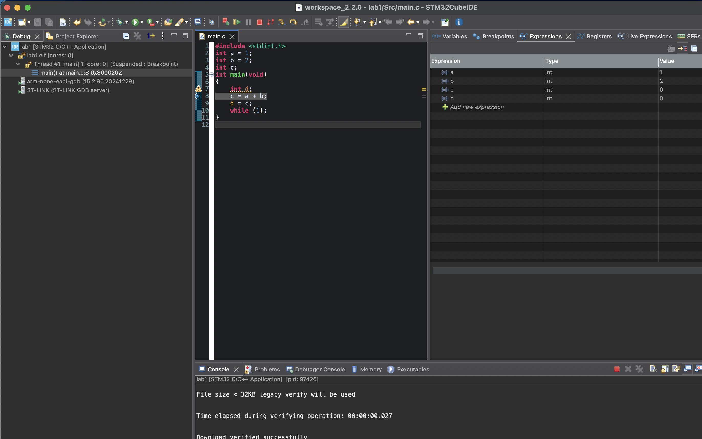
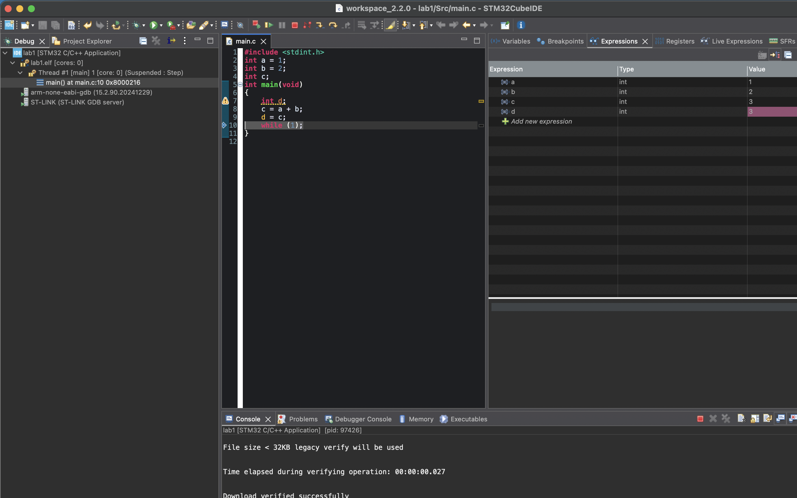
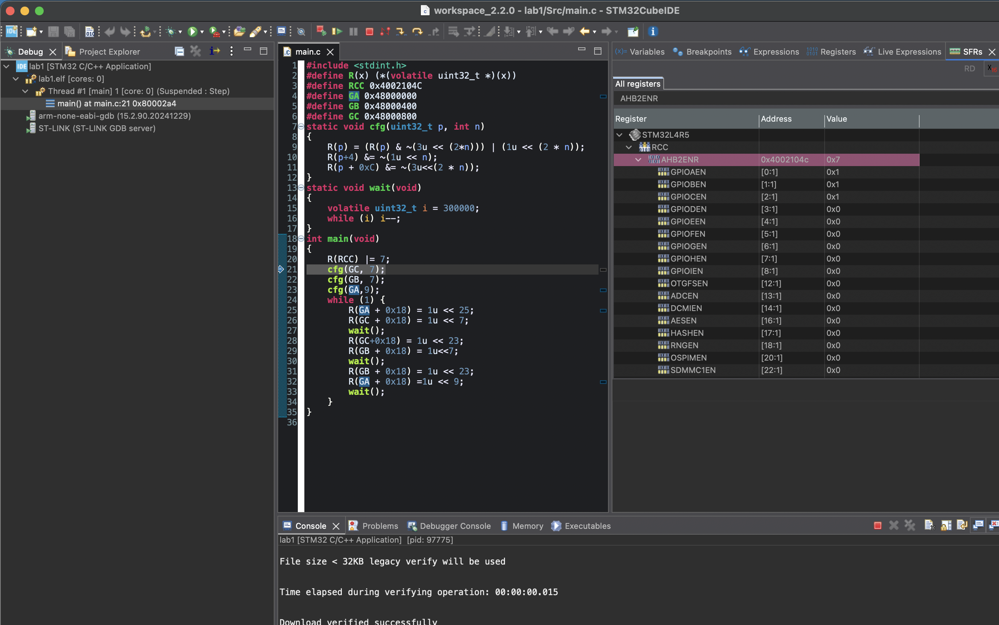

# Lab 1: Hello, World!

## Part 2: Flashing and Debugging Code

Code is in `part2/main.c`.

**What files are generated when you build the project?**
The compiler turns each source file (`main.c`, `syscalls.c`, `sysmem.c` and the startup file `startup_stm32l4r5zitxp.s`) into an object file in the `Debug` folder. The linker then combines them using `STM32L4R5ZITXP_FLASH.ld` into `lab1.elf`, which holds the machine code, data and debug symbols. The build also writes `lab1.map` (where every symbol ended up in memory), `lab1.list` (the disassembly) and a few small `.d` and `.su` files for dependencies and stack usage.

**What part of memory is written to on the MCU?**
The internal flash, starting at `0x08000000`. That is where the vector table, the code, constants and the starting values of initialized globals like `a` and `b` go. SRAM at `0x20000000` is not flashed. At reset the startup code copies the initial values into SRAM and zeroes `.bss`, which is where `c` lives.

**What enables STM32CubeIDE to communicate with your board?**
The ST-LINK/V2-1 debugger built into the top part of the Nucleo board. It connects to the computer over the micro USB port (CN1) and to the STM32L4R5 on the other side, so the computer never talks to the MCU directly.

**What tool or protocol is used to transfer the compiled binary to the microcontroller?**
CubeIDE starts the ST-LINK GDB server, and `arm-none-eabi-gdb` connects to it and loads `lab1.elf`. The ST-LINK then writes the binary into flash over SWD (Serial Wire Debug), which uses just two lines, SWDIO and SWCLK.

**Debugger screenshots**

Before the assignments, `a` is 1 and `b` is 2 because the startup code already copied them in, `c` is 0 since it is in `.bss`, and `d` reads 0 here only because that is what happened to be on the stack, since it has not been set yet.

After stepping, `c` and `d` are both 3. Once the program reaches `while (1);` nothing changes anymore and each step stays on the same line.

## Part 3: Blinking LEDs

Code is in `part3/main.c`.

The board has three user LEDs: LD1 is green and on PC7, LD2 is blue and on PB7, and LD3 is red and on PA9. These pins are used as GPIOs, meaning they are general purpose pins with no fixed job, and software decides through the GPIO registers whether each one reads a voltage or drives one. They should be outputs because the MCU has to drive the pin high to push current through the LED, and there is nothing to read back from an LED.

The clock enable register is RCC_AHB2ENR. The RCC base address is `0x40021000` and the offset is `0x4C`, so the register is at `0x4002104C`. Bits 0, 1 and 2 enable GPIOA, GPIOB and GPIOC, so after enabling all three the register reads `0x00000007`.

Each pin is set to general purpose output mode in MODER, push pull in OTYPER, and no pull up or pull down in PUPDR. The default low speed is fine for an LED. The LEDs are switched with BSRR so that only one pin changes per write.

Video: [blink.mov](part3/blink.mov)

## Part 4: Blinking LED in Assembly

Code is in `part4/main.c`. The inline assembly enables the GPIOB clock by setting bit 1 of RCC_AHB2ENR, sets PB7 to output mode in GPIOB_MODER, makes it push pull in GPIOB_OTYPER, and then writes bit 7 of GPIOB_BSRR to turn the blue LED on once.
